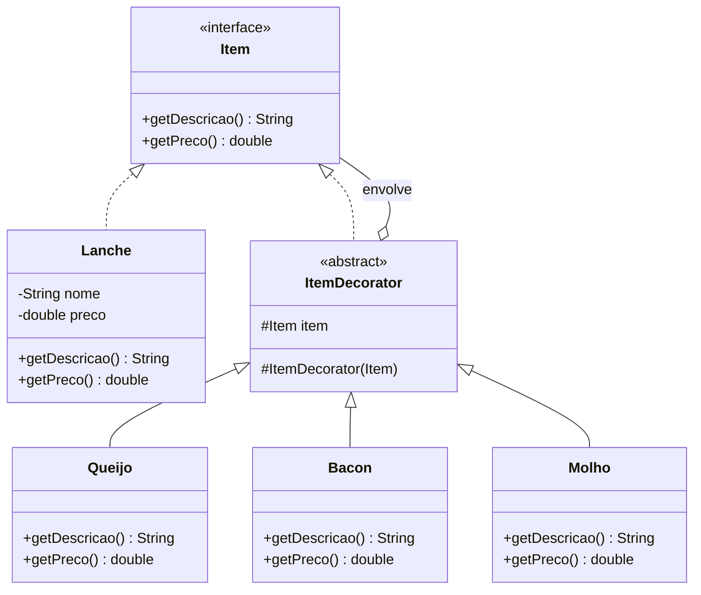
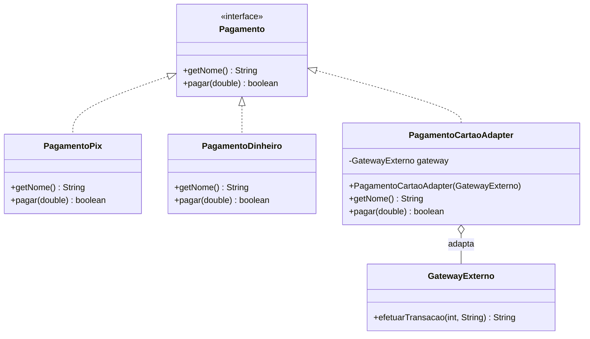

# Documentação dos Padrões de Projeto: Sistema da Lanchonete

* **Disciplinas:** Arquitetura de Software (Prof. Eder) & Programação Orientada a Objetos (Prof.ª Célia)
* **Curso:** Tecnologia em Análise e Desenvolvimento de Sistemas (TADS) — Univel
* **Autor:** Kauã Foscarini
* **Tecnologias:** Java (Swing) | Padrões GoF: **Builder**, **Decorator** e **Adapter**

---

## Visão geral do sistema

Sistema de pedidos de uma lanchonete desenvolvido em Java com interface gráfica desktop (`MainJanela`). O usuário monta lanches (com extras), cria o pedido com dados opcionais (endereço, observação, cupom `KAU10`), paga por Pix, cartão ou dinheiro e acompanha o status do pedido (`ATIVO` ou `CANCELADO`).

Padrões usados: **Builder** (criação do pedido), **Decorator** (montagem do lanche) e **Adapter** (pagamento por cartão via gateway externo).

### Organização dos pacotes

| Pacote | Classes | Responsabilidade Arquitetural |
| :--- | :--- | :--- |
| `lanchonete.decorator` | `Item`, `Lanche`, `ItemDecorator`, `Queijo`, `Bacon`, `Molho` | Montagem dinâmica dos lanches e cálculo recursivo de preço e descrição. |
| `lanchonete.modelo` | `Pedido`, `Pedido.Builder` | Regra de negócio do pedido, imutabilidade e validação na construção. |
| `lanchonete.adapter` | `Pagamento`, `PagamentoPix`, `PagamentoDinheiro`, `PagamentoCartaoAdapter`, `GatewayExterno` | Padronização dos pagamentos e adaptação de biblioteca externa. |
| `lanchonete.app` | `MainJanela` (e classes `Main`) | Camada de apresentação (Swing) que integra os três padrões sem acoplamento. |

### UML geral

```mermaid
classDiagram
    class MainJanela {
        -montarLancheAtual() Item
        -finalizarPedido() void
    }
    class Pedido {
        -int id
        -String cliente
        -String endereco
        -String observacao
        -String cupom
        -String formaPagamento
        -List~Item~ itens
        -Status status
        +getSubtotal() double
        +getTotal() double
        +cancelar() void
    }
    class Builder {
        +cliente(String) Builder
        +endereco(String) Builder
        +observacao(String) Builder
        +cupom(String) Builder
        +formaPagamento(String) Builder
        +item(Item) Builder
        +build() Pedido
    }
    class Item {
        <<interface>>
        +getDescricao() String
        +getPreco() double
    }
    class Lanche
    class ItemDecorator {
        <<abstract>>
        #Item item
    }
    class Queijo
    class Bacon
    class Molho
    class Pagamento {
        <<interface>>
        +getNome() String
        +pagar(double) boolean
    }
    class PagamentoPix
    class PagamentoDinheiro
    class PagamentoCartaoAdapter {
        -GatewayExterno gateway
    }
    class GatewayExterno {
        +efetuarTransacao(int, String) String
    }

    MainJanela ..> Builder : usa
    MainJanela ..> Pagamento : usa
    MainJanela ..> Item : usa
    Pedido +-- Builder : inner class
    Pedido o-- Item : contém
    Item <|.. Lanche
    Item <|.. ItemDecorator
    ItemDecorator o-- Item : envolve
    ItemDecorator <|-- Queijo
    ItemDecorator <|-- Bacon
    ItemDecorator <|-- Molho
    Pagamento <|.. PagamentoPix
    Pagamento <|.. PagamentoDinheiro
    Pagamento <|.. PagamentoCartaoAdapter
    PagamentoCartaoAdapter --> GatewayExterno : adapta
```

---

## 1. Builder

**Nome/Propósito:** Builder (padrão de criação). Separa a construção de um objeto complexo da sua representação final, permitindo montá-lo passo a passo.

**Motivação (problema):** um `Pedido` tem campos obrigatórios (cliente, itens, pagamento) e opcionais (endereço, observação, cupom). Com um construtor comum ficaria assim:

```java
// ANTES: sem o padrão
Pedido p = new Pedido("Ana", itens, "Pix", null, null, "KAU10");
// Qual argumento é qual? Quais são opcionais? É fácil trocar a ordem e ninguém percebe.
```

**Solução:** o `Pedido` tem construtor privado e uma classe interna `Builder`, com um método para cada campo e um `build()` que valida as regras antes de criar o objeto.

```java
// DEPOIS: com o Builder
Pedido p = new Pedido.Builder()
        .cliente("Ana")
        .item(lanche)
        .formaPagamento("Pix")
        .endereco("Rua das Flores, 123") // opcional (null = retirada no balcão)
        .observacao("Sem cebola")         // opcional
        .cupom("KAU10")                    // opcional (aplica 10% de desconto)
        .build();   // lança exceção se faltar cliente, item ou pagamento
```

**Classes envolvidas:** `Pedido` (produto) e `Pedido.Builder` (construtor). Código em `src/lanchonete/modelo/Pedido.java`.

```mermaid
classDiagram
    class Pedido {
        -int id
        -String cliente
        -String endereco
        -String observacao
        -String cupom
        -String formaPagamento
        -List~Item~ itens
        -Status status
        -Pedido(Builder)
        +getSubtotal() double
        +getTotal() double
        +cancelar() void
    }
    class Builder {
        -String cliente
        -String endereco
        -String observacao
        -String cupom
        -String formaPagamento
        -List~Item~ itens
        +cliente(String) Builder
        +item(Item) Builder
        +endereco(String) Builder
        +observacao(String) Builder
        +cupom(String) Builder
        +formaPagamento(String) Builder
        +build() Pedido
    }
    Pedido +-- Builder
    Builder ..> Pedido : cria
```

**Detalhes técnicos e pontos para explicar na apresentação:**
* **Por que o construtor é privado?** Para obrigar o uso do Builder e garantir a validação.
* **Por que cada método retorna `this`?** Para encadear as chamadas (*fluent interface*).
* **Onde fica a validação?** No `build()`, num único lugar — lança `IllegalStateException` caso `cliente` esteja em branco, `itens` esteja vazio ou `formaPagamento` seja nula.
* **Imutabilidade e Identificação:** Todos os atributos do `Pedido` são `final`, a lista de itens é protegida com `List.copyOf(b.itens)` e o `id` sequencial (`#1`, `#2`...) é gerado via `AtomicInteger SEQUENCIA`. Apenas o `status` muda de `ATIVO` para `CANCELADO` pelo método `cancelar()`.
* **Cálculo de Valores:** `getSubtotal()` soma `i.getPreco()` de todos os itens; `getTotal()` verifica se o cupom é `"KAU10"` (ignorando maiúsculas/minúsculas) e aplica 10% de desconto (`subtotal * 0.90`).

---

## 2. Decorator

**Nome/Propósito:** Decorator (padrão estrutural). Adiciona responsabilidades a um objeto dinamicamente, sem alterar sua classe e sem criar uma subclasse para cada combinação.

**Motivação (problema):** um lanche pode ter queijo, bacon, molho, ou qualquer combinação. Com herança:

```java
// ANTES: uma classe para cada combinação
class HamburguerComQueijo extends Hamburguer {}
class HamburguerComBacon extends Hamburguer {}
class HamburguerComQueijoEBacon extends Hamburguer {}
class HamburguerComQueijoBaconEMolho extends Hamburguer {}
// Com 3 extras já são 8 combinações, e cada extra novo dobra o número de classes.
```

**Solução:** cada extra é um decorator que implementa `Item`, recebe outro `Item` e soma sua descrição e seu preço. Os extras são empilhados em tempo de execução.

```java
// DEPOIS: com o Decorator
Item lanche = new Lanche("Hambúrguer", 20.0); // R$ 20,00
lanche = new Queijo(lanche);                  // + R$ 3,00
lanche = new Bacon(lanche);                   // + R$ 5,00
lanche = new Molho(lanche);                   // + R$ 2,00

lanche.getDescricao(); // "Hambúrguer + queijo + bacon + molho especial"
lanche.getPreco();     // 30.0
```

**Classes envolvidas:** `Item` (componente), `Lanche` (componente concreto — `"Hambúrguer"` R$ 20,00 ou `"Hot-dog"` R$ 15,00), `ItemDecorator` (decorator base com `protected final Item item`), `Queijo` (+R$ 3,00), `Bacon` (+R$ 5,00), `Molho` (+R$ 2,00) (decorators concretos). Código em `src/lanchonete/decorator/`.



**Detalhes técnicos e pontos para explicar na apresentação:**
* O decorator **é** um `Item` e **tem** um `Item` (herança e composição ao mesmo tempo). É isso que permite empilhar objetos como uma "cebola" em `MainJanela.montarLancheAtual()`.
* Adicionar um extra novo (ex.: ovo) é só criar **uma** classe, sem mexer nas existentes (princípio *Open/Closed*).
* Diferença para herança: a combinação é decidida em tempo de execução, não em tempo de compilação.

---

## 3. Adapter

**Nome/Propósito:** Adapter (padrão estrutural). Converte a interface de uma classe na interface que o cliente espera, permitindo que classes incompatíveis trabalhem juntas.

**Motivação (problema):** o sistema trabalha com a interface `Pagamento` (`pagar(double valor)`). Mas o gateway de cartão é uma biblioteca externa, que não podemos alterar, com outra interface: `efetuarTransacao(int centavos, String moeda)`, que devolve `"APROVADA"` ou `"RECUSADA"`.

```java
// ANTES: sem o padrão, o Main precisaria saber os detalhes do gateway
int centavos = (int) Math.round(total * 100);
String r = new GatewayExterno().efetuarTransacao(centavos, "BRL");
boolean ok = r.equals("APROVADA");
// E isso se repetiria em todo lugar que cobra no cartão.
```

**Solução:** o `PagamentoCartaoAdapter` implementa `Pagamento` e, por dentro, converte reais em centavos, chama o gateway e traduz a resposta.

```java
// DEPOIS: com o Adapter, o cartão é só mais um Pagamento
Pagamento pagamento = new PagamentoCartaoAdapter(new GatewayExterno());
boolean ok = pagamento.pagar(28.0);
```

**Classes envolvidas:** `Pagamento` (interface alvo), `GatewayExterno` (adaptada), `PagamentoCartaoAdapter` (adapter), `PagamentoPix` e `PagamentoDinheiro` (outras implementações nativas). Código em `src/lanchonete/adapter/`.



**Detalhes técnicos e pontos para explicar na apresentação:**
* **Tradução em 3 etapas (`PagamentoCartaoAdapter.pagar`):** (1) converte `double` para `int` centavos com `(int) Math.round(valor * 100)`; (2) chama `gateway.efetuarTransacao(centavos, "BRL")`; (3) converte a `String` para `boolean` com `"APROVADA".equals(resposta)`.
* O Adapter **muda** a interface (de `efetuarTransacao` para `pagar`). O Decorator **mantém** a interface e acrescenta comportamento.
* Se o gateway mudar, só o Adapter é alterado; o resto do sistema não percebe.
* Aqui foi usado o *object adapter* (composição: o adapter tem um `GatewayExterno`), que é a forma mais comum em Java.

---

## Como os três padrões se conectam no fluxo (`MainJanela.java`)

Na classe de interface gráfica `MainJanela`, os três padrões trabalham em conjunto com baixo acoplamento:

1. **Montagem do Lanche (`montarLancheAtual`):** O usuário escolhe o lanche base e marca os extras → **Decorator** empilha os adicionais em tempo de execução.
2. **Construção do Pedido (`finalizarPedido`):** Ao clicar em *"Finalizar pedido"*, o **Builder** reúne o cliente, os itens acumulados e os campos opcionais preenchidos na tela, validando as regras no `build()`.
3. **Cobrança Polimórfica (`finalizarPedido`):** A tela instancia `PagamentoPix`, `PagamentoDinheiro` ou `PagamentoCartaoAdapter(new GatewayExterno())` sob a mesma interface `Pagamento` → **Adapter** esconde a complexidade do gateway externo.
4. **Atualização da Tela:** Se `pagamento.pagar(pedido.getTotal())` retornar `true`, o pedido é adicionado à lista visual (`modeloPedidos`) e exibido via `toString()`.

---

## Resumo para defesa arquitetural

* **Por que não usar herança para os adicionais do lanche? (POO)**
  Para evitar a explosão de subclasses combinadas e respeitar o princípio *Open/Closed* (Aberto/Fechado): novos adicionais podem ser criados como novas classes sem modificar `Lanche` ou os adicionais já existentes.
* **Onde está o ganho arquitetural do Adapter? (Arquitetura de Software)**
  No desacoplamento entre a camada de apresentação/domínio e bibliotecas externas. Se a operadora de cartão (`GatewayExterno`) for substituída no futuro, apenas a classe `PagamentoCartaoAdapter` precisa ser alterada.
* **Por que o construtor de `Pedido` é privado? (POO & Arquitetura)**
  Para garantir integridade e imutabilidade do objeto de domínio, impedindo que qualquer parte do sistema instancie um `Pedido` sem cliente, sem itens ou sem forma de pagamento fora da validação centralizada do `Pedido.Builder`.
